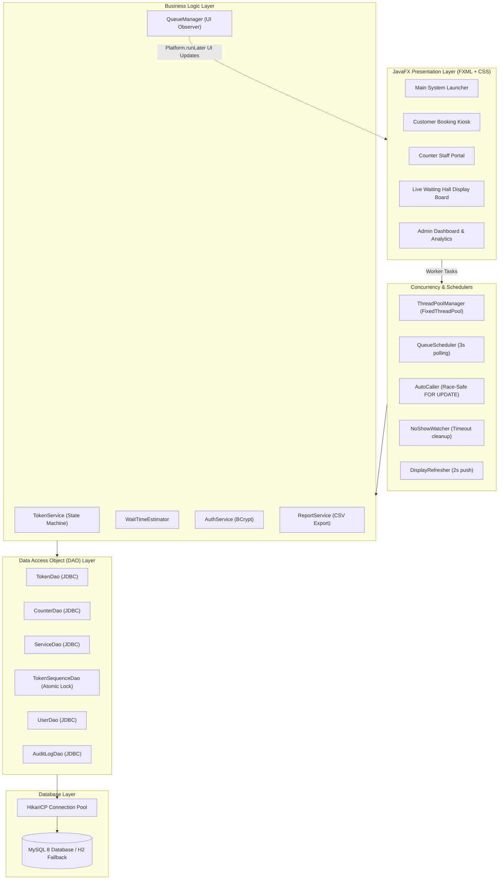
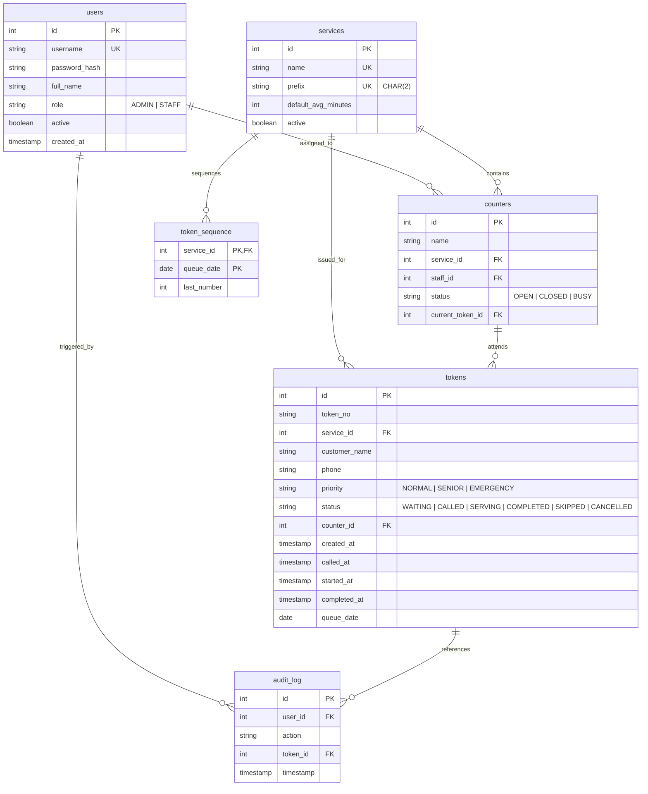

# Smart Queue and Token Management System

> **College 2nd-Year Project**  
> A complete, production-quality desktop queue and token management application built with **Java 17+**, **JavaFX 21**, **MySQL 8 / HikariCP**, and **Multithreading**.

---

## 📋 Table of Contents
1. [Project Overview](#1-project-overview)
2. [Key Features](#2-key-features)
3. [System Architecture](#3-system-architecture)
4. [Database ER Diagram](#4-database-er-diagram)
5. [Token State Machine](#5-token-state-machine)
6. [Multithreading & Concurrency Architecture](#6-multithreading--concurrency-architecture)
7. [Setup & Running Instructions](#7-setup--running-instructions)
8. [Default Demo Credentials](#8-default-demo-credentials)
9. [Automated Test Suite (30 Tests)](#9-automated-test-suite-30-tests)
10. [Documentation Links](#10-documentation-links)
11. [Troubleshooting](#11-troubleshooting)

---

## 1. Project Overview

The **Smart Queue and Token Management System** automates service desk queues for colleges, student service centers, clinics, or registrar offices.
- People book a digital token at a kiosk, view their real-time queue position and estimated waiting time, and receive a digital pass slip.
- When service counters become free, the system automatically calls the next eligible customer using priority-based scheduling and audio chime/speech announcements.
- Administrator analytics provide real-time KPIs, peak hour analysis, CSV data export, and an audit trail.

---

## 2. Key Features

| Role / Module | Core Functionality |
| :--- | :--- |
| **Customer Kiosk** | Department selection, input validation, priority flagging (Senior/Medical), dynamic wait estimate preview, digital token pass card, "💾 Print / Save Slip (TXT)", and "🔍 Check My Token Status" live tracking. |
| **Counter Staff Portal** | Counter desk selection, Call Next, Start Serving (duration timer), Complete, Skip (No-Show), Recall to queue, Transfer to another department, and "Auto-Call Next when Free" toggle. |
| **Live Display Board** | High-contrast waiting-hall signage: real-time digital clock, large electronic cards for active counters, next 5 waiting tokens, and hardware chime/voice announcement playback. |
| **Admin Dashboard** | Real-time KPI summaries (Total, Completed, Skipped, No-show rate %, Avg Wait, Avg Service), Tokens Processed BarChart, Hourly Queue Traffic (Peak Hours) BarChart, Department and Counter management, Staff account registration (BCrypt), CSV report export, and full System Audit Trail table. |
| **Concurrency Layer** | Non-blocking JavaFX UI, atomic row-level locking (`SELECT ... FOR UPDATE`), scheduled 3-second auto-calling, 2-minute automated no-show watcher, and 2-second display board polling. |

---

## 3. System Architecture

The application strictly follows the **Model-View-Controller (MVC) + Layered DAO** architecture:



---

## 4. Database ER Diagram



---

## 5. Token State Machine

The token lifecycle is strictly enforced by `TokenService.validateTransition()`. Any illegal state transition throws an `AppException` and is blocked:

```mermaid
stateDiagram-v2
    [*] --> WAITING : Customer books token at Kiosk
    WAITING --> CALLED : Staff / AutoCaller calls next
    WAITING --> CANCELLED : Customer or Admin cancels
    CALLED --> SERVING : Customer arrives; Staff starts serving
    CALLED --> SKIPPED : Customer no-show after timeout (2 min)
    SERVING --> COMPLETED : Service completed
    SKIPPED --> WAITING : Staff recalls customer (goes to back of queue)

    COMPLETED --> [*]
    CANCELLED --> [*]
```



### Queue Ordering & Starvation Prevention Rule:
1. **Rank 0 (`EMERGENCY`):** Medical emergency, physical disability.
2. **Rank 1 (`SENIOR`):** Senior citizen (60+), pregnant mother.
3. **Rank 2 (`NORMAL`):** Standard queue pass.
- **Starvation Prevention:** Any `NORMAL` customer waiting $\ge 30$ minutes is automatically elevated to **Rank 1** (`SENIOR`) so they are not starved by a continuous stream of newer arrivals.
- Within the same priority rank, strict **FIFO (First-In, First-Out)** by `created_at` timestamp applies.

---

## 6. Multithreading & Concurrency Architecture

1. **JavaFX Thread Protection:** The JavaFX Application Thread never executes SQL or file I/O. All asynchronous background tasks run in a dedicated `FixedThreadPool` (`ThreadPoolManager.getInstance().submitWorkerTask()`).
2. **Race-Safe Calling:** When multiple counters call for the next token simultaneously, `AutoCaller` executes:
   ```sql
   SELECT id FROM tokens 
   WHERE service_id = ? AND status = 'WAITING' 
   ORDER BY ... LIMIT 1 FOR UPDATE
   ```
   This locks the single highest-priority row. The status is updated to `CALLED` within the transaction, guaranteeing **zero duplicate token claims**.
3. **Atomic Sequence Generation:** Sequential token numbers (`AD-001`, `CL-002`) are allocated under an atomic transaction with row locking on `token_sequence`.
4. **No-Show Watcher:** `NoShowWatcher` checks for `CALLED` tokens exceeding the timeout (120s), transitions them to `SKIPPED`, and frees the counter back to `OPEN`.
5. **Clean Shutdown:** `SmartQueueApp.stop()` terminates all thread pools via `awaitTermination()` and shuts down HikariCP cleanly, leaving no orphaned threads.

---

## 7. Setup & Running Instructions

### Prerequisites
- **JDK 17 or higher** (`java -version`)
- **Apache Maven 3.8+** (`mvn -version`)
- *(Optional)* MySQL Server 8.0+

### Option A: Running in Zero-Config Demo Mode (No MySQL Required!)
If MySQL is not installed on the presentation computer, simply run:
```bash
mvn clean javafx:run
```
The application detects that MySQL is offline and automatically launches an **embedded in-memory H2 database** with the complete schema and seed data. **Zero setup required for viva presentations!**

### Option B: Running with Live MySQL 8.0
1. Open MySQL Workbench or terminal and execute:
   ```sql
   CREATE DATABASE IF NOT EXISTS smart_queue_db;
   USE smart_queue_db;
   SOURCE database/schema.sql;
   SOURCE database/seed.sql;
   ```
2. Verify credentials in `src/main/resources/db.properties`:
   ```properties
   db.url=jdbc:mysql://localhost:3306/smart_queue_db?useSSL=false&allowPublicKeyRetrieval=true&serverTimezone=UTC&createDatabaseIfNotExist=true
   db.username=root
   db.password=Admin@123
   ```
3. Run:
   ```bash
   mvn clean javafx:run
   ```

---

## 8. Default Demo Credentials

| Role | Username | Password | Default Desk / Assignment |
| :--- | :--- | :--- | :--- |
| **Admin** | `admin` | `Admin@123` | Full administrative control & analytics |
| **Staff** | `staff1` | `Staff@123` | Admissions Desk (Counter 1) |
| **Staff** | `staff2` | `Staff@123` | Clinic Desk (Counter 2) |

*(Quick helper buttons "Fill Admin" and "Fill Staff" are embedded directly in the login dialog for instant 1-click viva demonstrations).*

---

## 9. Automated Test Suite (30 Tests)

Run all unit and concurrency tests with Maven:
```bash
mvn clean test
```

### Test Coverage Summary:
- **`ConcurrentCallNextTest`:** Simulates 10 concurrent counters calling next for 5 tokens; asserts exactly 5 distinct tokens claimed, 0 duplicates, and 5 empty queue results.
- **`ConcurrentBookingTest`:** 5 concurrent threads booking tokens simultaneously; asserts 5 unique sequential token numbers with no duplicates.
- **`TokenStateMachineTest` (12 tests):** Verifies all legal state transitions succeed and all illegal transitions throw `AppException`.
- **`PriorityOrderingTest` (3 tests):** Verifies Emergency beats Senior beats Normal, starvation elevation after 30 min, and FIFO tie-breaking.
- **`WaitTimeEstimatorTest` (4 tests):** Verifies wait-time calculation, recent duration averaging, and fallback to default service duration.
- **`DatabaseDaoTest` (6 tests):** Verifies User, Service, Counter, Token, and AuditLog JDBC persistence with transaction rollbacks.
- **`PasswordUtilTest`:** Verifies BCrypt cryptographic salt generation and password verification.
- **`TokenGeneratorTest` (2 tests):** Verifies priority queue ordering and FIFO sorting.

---

## 10. Documentation Links

- **[docs/VIVA.md](docs/VIVA.md):** 15 in-depth viva examination questions with technical answers for 2nd-year CSE students.
- **[docs/DEMO_SCRIPT.md](docs/DEMO_SCRIPT.md):** A step-by-step 5-minute presentation script demonstrating priority override, auto-calling, and live reporting.
- **[docs/CODE_WALKTHROUGH.md](docs/CODE_WALKTHROUGH.md):** Detailed directory map explaining where every pattern and class lives in the codebase.

---

## 11. Troubleshooting

| Symptom | Cause | Solution |
| :--- | :--- | :--- |
| `Communications link failure` on startup | MySQL server is offline or not installed | Expected behavior: the app automatically switches to embedded H2 demo mode with full seed data. |
| Port 3306 connection refused | MySQL service stopped | Start MySQL via Windows Services or use the automatic zero-config H2 fallback. |
| JavaFX compilation warnings | OpenJFX modular dependencies | Safe to ignore; standard Maven JavaFX plugin notices. |
| Font rendering or audio chime mute | Audio output muted in OS | Unmute desktop audio; text announcement will still display visually on screen. |
